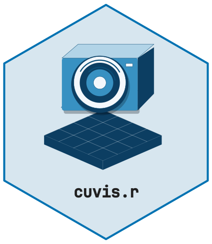
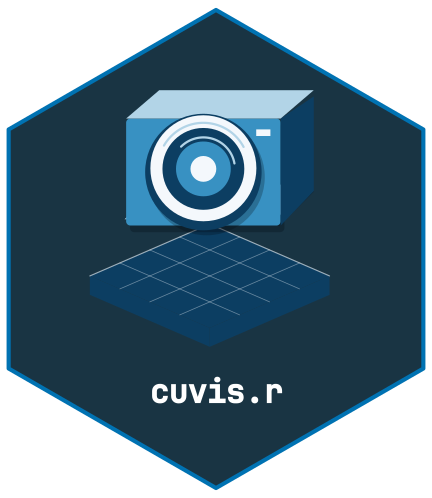

# Getting Started with cuvis.r



[](https://github.com/CTTIR/cuvis.r/actions/workflows/R-CMD-check.yaml)
[](https://cttir.github.io/cuvis.r/)
[](https://app.codecov.io/gh/CTTIR/cuvis.r?branch=main)
[](https://opensource.org/licenses/Apache-2.0)
[](https://lifecycle.r-lib.org/articles/stages.html#experimental)

## Overview

**cuvis.r** provides R bindings to the Cubert CUVIS C SDK for reading,
processing, and exporting hyperspectral imaging data from Cubert
snapshot cameras. It mirrors the API of
[cuvis.python](https://github.com/cubert-hyperspectral/cuvis.python).

## Prerequisites

1.  Install the **Cubert CUVIS SDK** for a supported Linux or Windows
    platform from
    <https://github.com/cubert-hyperspectral/cuvis.sdk/releases>
2.  Set the `CUVIS_SDK` environment variable to the SDK install
    directory
3.  Install cuvis.r from GitHub:

``` r

remotes::install_github("cttir/cuvis.r")
```

## Quick Start

The SDK may be initialized only once per R process. Keep it active for
the whole batch, then shut down once. Restart R before another batch
after shutdown. macOS supports stub installation, not the vendor
runtime. Exports require a new or empty directory unless
`overwrite = TRUE` is explicitly requested.

### Initialize the SDK

Every cuvis.r session begins with
[`cuvis_init()`](https://cttir.github.io/cuvis.r/reference/cuvis_init.md)
and ends with
[`cuvis_shutdown()`](https://cttir.github.io/cuvis.r/reference/cuvis_shutdown.md):

``` r

library(cuvis.r)

cuvis_init()
```

### Load a Session File

Cubert cameras store measurements in `.cu3s` session files. Load one
with
[`cuvis_session()`](https://cttir.github.io/cuvis.r/reference/cuvis_session.md):

``` r

session <- cuvis_session("path/to/measurement.cu3s")
print(session)
```

### Extract a Measurement

Session files contain one or more measurements. Access them by index
(1-based):

``` r

mesu <- cuvis_get_measurement(session, 1)
print(mesu)
```

### Inspect Metadata

``` r

md <- cuvis_get_metadata(mesu)
md$name
md$integration_time
md$serial_number
md$product_name
```

### Get the Data Cube

The hyperspectral data cube is returned as a 3D R array
`[rows, cols, bands]` with wavelength metadata attached:

``` r

# First, process to generate the cube
ctx <- cuvis_processing_context(session)
cuvis_reprocess(ctx, mesu, mode = "raw")

cube <- cuvis_get_cube(mesu)
dim(cube)                        # e.g., c(100, 100, 61)
attr(cube, "wavelengths")        # wavelengths in nm
```

You can subset bands, compute means, or use standard R array operations:

``` r

# Mean reflectance per band
band_means <- apply(cube, 3, mean, na.rm = TRUE)

# Extract a single band (e.g., band 30)
single_band <- cube[, , 30]
image(single_band, main = "Band 30")
```

### Export to Standard Formats

``` r

# ENVI format (widely supported by remote sensing tools)
cuvis_export_envi(mesu, "output/envi/")

# Multi-channel TIFF
cuvis_export_tiff(mesu, "output/tiff/")
```

### Shutdown

``` r

cuvis_shutdown()
```

## Next Steps

- See
  [`vignette("cuvis-r-calibration")`](https://cttir.github.io/cuvis.r/articles/cuvis-r-calibration.md)
  for the full calibration workflow (dark/white references, reflectance
  conversion)
- See the [cuvis.python
  examples](https://github.com/cubert-hyperspectral/cuvis.python.examples)
  for workflow patterns that translate directly to cuvis.r
