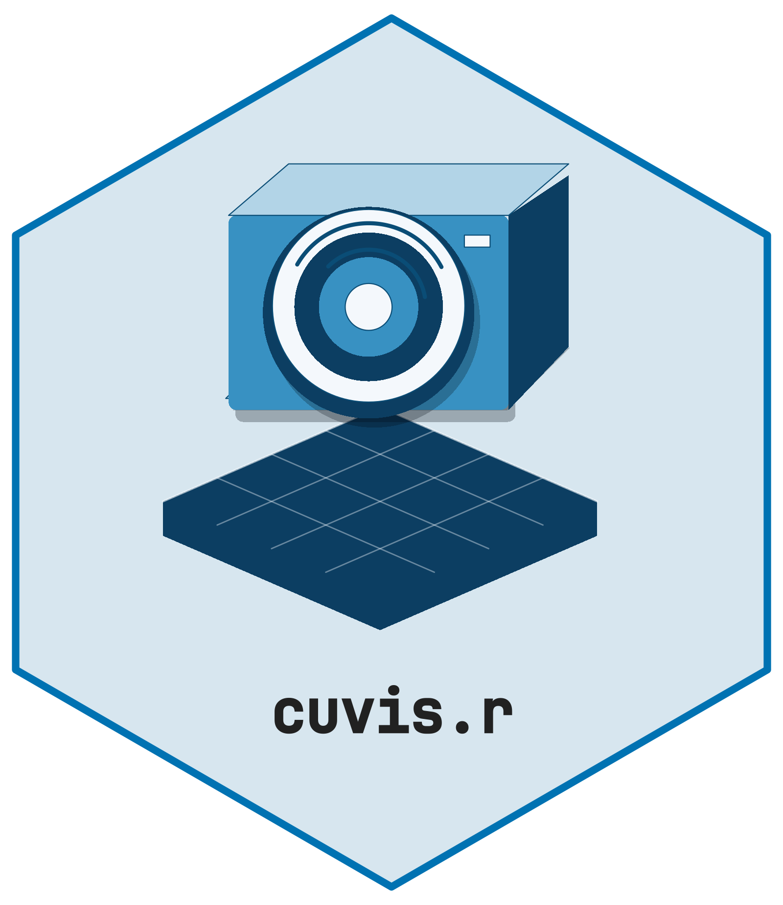

# cuvis.r 

**cuvis.r** provides R bindings to the [Cubert CUVIS
SDK](https://cubert-hyperspectral.com/en/knowledge/cuvis-sdk/) for
reading, calibrating, and exporting hyperspectral data from Cubert
cameras.

This is the R equivalent of
[cuvis.python](https://github.com/cubert-hyperspectral/cuvis.python).

## Prerequisites

1.  **Install a supported Cubert CUVIS SDK** from the [official
    releases](https://github.com/cubert-hyperspectral/cuvis.sdk/releases).
    The wrapper compiles against the 3.6.1 header. The vendor currently
    distributes Linux and Windows runtimes; macOS supports the stub
    installation only. Older SDK versions require separate
    qualification.
2.  Set the `CUVIS_SDK` environment variable to the install directory
3.  (Optional) Download sample data from
    [cloud.cubert-gmbh.de](https://cloud.cubert-gmbh.de/s/SrkSRja5FKGS2Tw)

## Installation

``` r

# install.packages("remotes")
remotes::install_github("cttir/cuvis.r")
```

For source installation, R \>= 4.1 and a C compiler are required (Rtools
on Windows, command-line developer tools on macOS). Set `CUVIS_SDK` to
the SDK installation root before installation; both `cuvis.h` and a
matching library must be present. On Windows, also put the SDK’s runtime
`bin` directory on `PATH` **before starting R** so Windows can resolve
the DLL dependencies. Setting an SDK variable alone does not establish a
working runtime. For package exploration without the SDK:

``` sh
CUVIS_STUB=1 R CMD INSTALL .
Rscript -e 'library(cuvis.r); stopifnot(!cuvis_available())'
```

A stub cannot open, calibrate or export measurements.
[`cuvis_available()`](https://cttir.github.io/cuvis.r/dev/reference/cuvis_available.md)
checks whether the SDK was linked; it does not establish runtime or
calibration readiness. For real measurements, also set `CUVIS_SETTINGS`
to the directory containing the correct factory/user calibration and
provide a valid `.cu3s` recording.

Initialize once per R process. Repeated initialization with the same
settings is safe while the SDK remains active. After
[`cuvis_shutdown()`](https://cttir.github.io/cuvis.r/dev/reference/cuvis_shutdown.md),
restart R before using the SDK again; do not unload/reload the package
to restart it. Run the following examples in separate R sessions, or
postpone shutdown until the whole batch is finished.

Exports now require a new or empty directory by default. Use
`overwrite = TRUE` only to permit replacement deliberately. This changes
the previous overwrite behavior. Successful export waits for the SDK
flush and releases the exporter; flush errors propagate to the caller.
Directory paths longer than the SDK’s 255-byte limit are rejected. Use
plain paths: SDK 3.6.1 lists special characters in export paths as a
known vendor limitation. Do not use the same output directory
concurrently.

## Quick Start

``` r

library(cuvis.r)

cuvis_init()

# Load a session file
session <- cuvis_session("path/to/measurement.cu3s")
print(session)

# Extract the data cube
mesu <- cuvis_get_measurement(session, 1)
ctx <- cuvis_processing_context(session)
cuvis_reprocess(ctx, mesu, mode = "raw")
cube <- cuvis_get_cube(mesu)
dim(cube)                        # [rows, cols, bands]
attr(cube, "wavelengths")        # wavelengths in nm

# Calibrate to reflectance
cuvis_reprocess(ctx, mesu, mode = "reflectance")
ref_cube <- cuvis_get_cube(mesu)

# Export to ENVI
cuvis_export_envi(mesu, "output/")

cuvis_shutdown()
```

## Full Calibration Workflow

``` r

cuvis_init()

session <- cuvis_session("measurement.cu3s")
mesu <- cuvis_get_measurement(session, 1)

# Load separate dark/white reference files
dark_session <- cuvis_session("dark.cu3s")
white_session <- cuvis_session("white.cu3s")

ctx <- cuvis_processing_context(session)
cuvis_set_reference(ctx, cuvis_get_measurement(dark_session, 1), "dark")
cuvis_set_reference(ctx, cuvis_get_measurement(white_session, 1), "white")

cuvis_reprocess(ctx, mesu, mode = "reflectance")
ref_cube <- cuvis_get_cube(mesu)

cuvis_shutdown()
```

## API Reference

| Function | Description |
|----|----|
| [`cuvis_init()`](https://cttir.github.io/cuvis.r/dev/reference/cuvis_init.md) | Initialize the CUVIS SDK |
| [`cuvis_shutdown()`](https://cttir.github.io/cuvis.r/dev/reference/cuvis_shutdown.md) | Release SDK resources |
| [`cuvis_available()`](https://cttir.github.io/cuvis.r/dev/reference/cuvis_available.md) | Check if SDK is linked |
| `cuvis_session(path)` | Load a `.cu3s` session file |
| `cuvis_get_measurement(session, i)` | Extract measurement by index |
| `cuvis_get_metadata(mesu)` | Get measurement metadata |
| `cuvis_get_cube(mesu)` | Extract 3D data array |
| `cuvis_get_wavelengths(mesu)` | Get wavelength vector |
| `cuvis_processing_context(session)` | Create calibration context |
| `cuvis_set_reference(ctx, mesu, type)` | Set dark/white reference |
| `cuvis_reprocess(ctx, mesu, mode)` | Reprocess to target level |
| `cuvis_export_envi(mesu, dir)` | Export to ENVI format |
| `cuvis_export_tiff(mesu, dir)` | Export to TIFF format |
| `cuvis_export_session(mesu, dir)` | Export to .cu3s format |

## Integration with hyperspectR

cuvis.r is designed as the I/O backend for
[hyperspectR](https://github.com/CTTIR/hyperspectR):

``` r

library(hyperspectR)

# hyperspectR uses cuvis.r internally for .cu3s files
cube <- hs_read_cubert("measurement.cu3s")
```

## License

Apache License 2.0

## Citation

If you use this software, please cite it as:

> Heller, R. (2026). *cuvis.r: R bindings for the Cubert CUVIS
> hyperspectral SDK* \[Computer software\].
> <https://github.com/CTTIR/cuvis.r>

The Zenodo metadata is a draft; no published DOI is claimed.

## Use of LLM tools

Where applicable, LLM tools were used for narrowly defined,
non-authorial tasks: copyediting, prose refinement, Markdown/LaTeX
formatting, boilerplate scaffolding (such as CI configurations and build
scripts), and code refactoring. Tools included [Chat
AI](https://kisski.gwdg.de/leistungen/2-02-llm-service/), the KISSKI
(GWDG) service, and self-hosted **Mistral Small (24B, Apache-2.0)**
served through a local **vLLM architecture** on an Ubuntu Linux
workstation with Intel processors and NVIDIA GPUs. Self-hosted use also
includes models that were further trained (fine-tuned) or weight-edited
in-house for specific tasks. All self-hosted models ran locally, with no
data sent to third parties.

All scientific claims, methodological choices, analyses, interpretations
and conclusions remain the authors’ own. Where applicable, LLM-generated
material must be reviewed and revised before inclusion, and references
must be verified against their DOI, arXiv ID or ISBN.

Local software setup: vLLM with Python/PyTorch, plus R and RStudio.

## Branding

Editable R sources and regeneration instructions are in
[tools/branding](https://github.com/CTTIR/cuvis.r/tree/main/tools/branding).

## Developer validation

``` sh
python3 tools/test-configure.py
python3 tools/test-native.py /path/to/vendor/cuvis.h
CUVIS_STUB=1 R CMD build .
CUVIS_STUB=1 R CMD check --as-cran cuvis.r_0.1.1.9000.tar.gz
```

The native fixture checks memory layout, malformed buffers, lifecycle
and export arguments with synthetic SDK responses. It does not validate
vendor calibration, real files, runtime linking, or camera operation.
See `MAINTENANCE.md` for the release gates and observed evidence.
